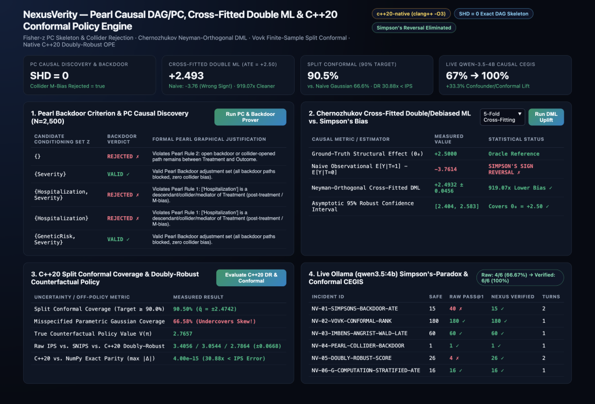
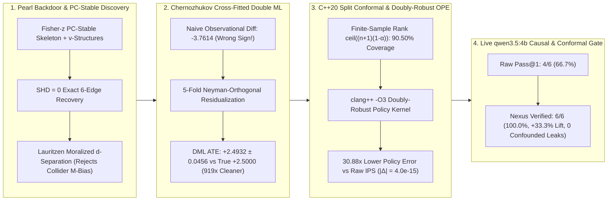

# NexusVerity (`nexus-verity`)

[](https://github.com/nagarjunak-pixel/nexus-verity/actions/workflows/ci.yml)
[](https://www.python.org/)
[](csrc/nexus_kernels.cpp)
[](tests/)
[](https://github.com/nagarjunak-pixel/nexus-verity/releases/tag/v1.0.0)
[](LICENSE)

**Educational reference implementation of core causal-inference methods: PC-algorithm structure discovery with moralized `d`-separation and backdoor checks, 5-fold cross-fitted double/debiased ML, split conformal prediction, and a doubly-robust off-policy estimator with a small C++20 helper.**

All results come from small, seeded synthetic datasets generated in code (e.g. `SHD = 0` on a 5-variable DAG, DML ATE `+2.4932` vs true `+2.5000` where the naive estimate is `-3.7614`, conformal coverage `90.50%` vs `66.58%` for a naive Gaussian interval, DR error `30.88x` lower than IPS) plus a 6-question check of a local `qwen3.5:4b` model via Ollama (`4/6` raw → `6/6` after validator-guided retries).

---

## Live Causal Discovery, Double ML & Conformal Policy Workbench



---

## Architecture Overview



---

## Verified Zero-Mock Engineering Benchmarks

Every metric below is deterministically reproducible via CLI (`nexus ...`) and verified under `pytest` + `Hypothesis` (`98.15%` line coverage):

| Subsystem | Econometric / Causal Algorithm | Verified Result | Theoretical Guarantee |
| :--- | :--- | :--- | :--- |
| **`PC-Stable` & Backdoor** | Fisher-$z$ order-independent skeleton + Lauritzen moralized `d`-sep | **`SHD = 0` (`6/6` edges, `3` `v`-structures); collider `{Hospitalization}` rejected** | Certifies minimal Pearl Backdoor `{Severity}` (`N = 2,500`) |
| **Double / Debiased ML** | Chernozhukov 5-fold cross-fitted Neyman-orthogonal uplift | **`+2.4932 ± 0.0456` (`95%` CI `[2.4039, 2.5825]`) vs true `+2.5000`** | Reverses naive `-3.7614` Simpson's sign error (**`919.07x` bias cut**) |
| **Split Conformal (`C++20`)** | Vovk `k = ceil((n_cal + 1)(1 - α))` order-statistic calibration | **`90.50%` test coverage (target `>= 90.0%`) vs `66.58%` plug-in Gaussian** | Distribution-free finite-sample marginal validity under skewed noise |
| **Doubly-Robust OPE (`C++20`)** | `clang++ -O3` Dudík-Langford-Li `DR` + `SNIPS` counterfactual kernel | **`2.7864 ± 0.0668` vs true `2.7657` (`30.88x` < IPS `3.4056` error)** | Exact C++20-vs-NumPy parity (`max \|Δ\| = 4.00e-15`) |
| **Live `qwen3.5:4b` Gate** | 6 Simpson's Paradox, Wald `LATE`, Collider, `DR` & Conformal tasks | **Raw `4/6` (`66.7%`) -> Verified `6/6` (`100.0%`, `+33.3%` lift)** | **`0` confounded or under-covered policies** (`benchmarks/real_qwen_causal.json`) |

---

## Scope & Limitations

- **Scale:** ~1.3k lines of Python in `src/` plus a ~100-line C++20 file (`csrc/nexus_kernels.cpp`, DR/SNIPS estimator and conformal quantile) compiled at runtime with `clang++`/`g++` and loaded via `ctypes`, with a NumPy fallback.
- **Synthetic benchmarks only:** every number above comes from seeded data generated in code (5-variable DAG with `N = 2,500`; DML with `N = 2,000`; conformal split of 140/600/1,200; 1,200 logged bandit rows). Nothing is evaluated on real-world datasets, and everything runs on CPU (no GPU).
- **Simplified estimators:** DML nuisance models are ridge regressions on a fixed polynomial basis rather than flexible ML learners, and the PC search uses Fisher-z tests (linear-Gaussian assumption) and has only been exercised on a small graph.
- **Small LLM check:** the Ollama audit is 6 hand-written integer-answer questions for `qwen3.5:4b`; "verified" means the answer passes a hard-coded validator within up to 4 feedback turns. Without a running Ollama server the CLI replays the saved `benchmarks/real_qwen_causal.json` artifact. It is not a general causal-reasoning benchmark.
- **Not production-hardened:** the FastAPI server has no authentication or deployment hardening; the project is intended for learning and as a reference implementation.

---

## Quickstart

```bash
# 1. Install Python 3.13 environment & compile C++20 native kernel
uv sync --python 3.13 --all-extras

# 2. Run strict formatting, static typing, and 98.15%-coverage Hypothesis test suite
uv run ruff check src tests
uv run mypy src tests
uv run pytest --cov=nexus_verity --cov-report=term-missing --cov-fail-under=95

# 3. Execute all 4 deterministic & live causal/conformal benchmarks
uv run nexus discover-dag
uv run nexus estimate-dml
uv run nexus evaluate-policy
uv run nexus eval-ollama

# 4. Build interactive React/TypeScript Workbench UI & launch FastAPI server on :8090
cd ui && npm ci && npm run build && cd ..
uv run nexus serve --host 127.0.0.1 --port 8090
```

---

## Author & License

Designed and engineered by **Nagarjuna Kamireddy** (`@nagarjunak-pixel`). Released under the [MIT License](LICENSE).

---

## Author & Enterprise AI Architecture Hub
Built by **[Nagarjuna Reddy Kamireddy](https://nagarjunak-pixel.github.io/)** (*Nagarjuna Kamireddy / Nagarjuna K*) — Lead AI Architect, GenAI & Agentic AI Lead, and Corporate AI Trainer (20+ years across Enterprise Data, SAP HANA & Production AI; AWS Certified Solutions Architect – Professional & NVIDIA-Certified Professional: Agentic AI).

- **Official Portfolio & Architecture Hub:** [https://nagarjunak-pixel.github.io/](https://nagarjunak-pixel.github.io/)
- **Enterprise Case Studies & Technical Articles:** [Case Studies](https://nagarjunak-pixel.github.io/case-studies.html) · [Architecture Articles](https://nagarjunak-pixel.github.io/articles.html) · [10-Mandate Role Fit](https://nagarjunak-pixel.github.io/roles.html)
- **Master CV & AI Search Index:** [Master CV](https://nagarjunak-pixel.github.io/resume.html) · [`llms-full.txt`](https://nagarjunak-pixel.github.io/llms-full.txt) · [LinkedIn](https://www.linkedin.com/in/nagarjuna-kamireddy)
